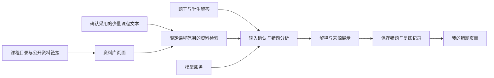

# SCUT 课程资料与错题复习助手设计大纲

版本 v0.1　更新日期 2026 年 10 月 12 日　团队 WHY CodingKing

本稿用于确定产品范围、页面、数据和技术方案。正文对应比赛附件 2 的六个章节，并补充需要队长逐轮决定的问题。最终参赛 Word 将根据确认后的设计和实际完成情况填写。

## 当前已经确认的方向

| 项目 | 已确认内容 |
| --- | --- |
| 项目方向 | 课程资料库与错题复习助手，面向华工学生的学习场景 |
| 产品入口 | 资料库与错题复习并重，都作为主要入口 |
| 首版使用方式 | 本机演示，找组员试用和验证流程 |
| 时间约束 | 距本轮提交不足三天，不要求队长重新整理整门课的资料 |
| 数据方案 | SCUT 仓库先提供课程目录和原文链接；AI 先使用现成、可读取的公开中文线代笔记，明确标注来源 |
| 首版内容范围 | 以方程组、矩阵消元等少量线代内容完成可演示流程；具体纳入的文件仍需列清单 |
| 工作方式 | 多轮设计确认后再进入代码实现；每个功能的输入、输出和验收方式须先让队长理解 |

上述决定不包含前端框架、数据库产品、图片识别、自动出题或公网部署的选型。这些事项保留在后续确认轮次。

官方赛事接口本次核查显示，报名和本轮作品提交截止均为 **2026 年 10 月 15 日 15:00**。后续排期以用户确认的范围为前提。[赛事页面](https://ecloud.10086.cn/api/query/developer/match/matchDetails.html?id=8c5343ad69dd4e82bf7af642c14c8ff5)

## 调研依据

### 学长项目的候选

截至本次查询，最符合“华工计算机专业、基础课程资料、约一百个 star”的候选是 [AlexBybye/SCUT_CS](https://github.com/AlexBybye/SCUT_CS)，GitHub API 返回 122 个 star，课程包括工科数学分析和线性代数。学长本人身份尚未核实，不能仅凭这些特征确定是同一项目。

另两个候选是 [4512abc/SCUT](https://github.com/4512abc/SCUT)，约 162 个 star，面向软件学院；以及 [OpenFuTech/SCUT-FT-Guide](https://github.com/OpenFuTech/SCUT-FT-Guide)，约 95 个 star，面向未来技术学院。星数是查询时的快照。

SCUT_CS 的 [应用说明](https://github.com/AlexBybye/SCUT_CS/blob/master/apps/scut-senior/README.md) 已描述课程问答、错题讲解、引用定位和个人知识保存等能力。本次查阅了公开说明和资料样本，未实际运行其应用。因此，我方特色需要围绕具体使用流程和实测结果进一步确认，不能把“课程问答加错题分析”本身写成首次出现的创新。

可借鉴的经验是：按课程组织资料，保留原文件和位置，限制回答所使用的课程范围，明确公共资料和个人学习记录的关系。比赛规则提及对直接套用开源代码等行为的限制，因此应记录外部参考与我方独立完成的设计、实现和验证内容。[官方规则](https://ecloud.10086.cn/api/query/developer/match/matchDetails.html?id=8c5343ad69dd4e82bf7af642c14c8ff5)

### 现成资料能节省多少工作

已检查 SCUT_CS 的 [线代知识目录](https://github.com/AlexBybye/SCUT_CS/tree/master/apps/scut-senior/knowledge/linear_algebra)。其中 23 份 Markdown 文档有 11 份正文仅引用图片；部分其余文件存在公式断裂。其 [转换清单](https://github.com/AlexBybye/SCUT_CS/blob/master/apps/scut-senior/knowledge/manifest.csv) 也保留了等待人工复核、部分文件未进行 OCR 的说明。文件扩展名是 Markdown，并不代表内容已经适合直接检索和分析。

作为首版 AI 资料候选，已抽查 ApacheCN 中文线代笔记的 [方程组的几何解释](https://github.com/apachecn/mit-18.06-linalg-notes/blob/master/docs/chapter01.md) 和 [矩阵消元](https://github.com/apachecn/mit-18.06-linalg-notes/blob/master/docs/chapter02.md)：两章包含可读取的中文正文与 LaTeX 公式，适合作为少量资料接入的起点。抽查确认的是格式可读性，知识准确性与章节完整性仍须在采用时复核。

该笔记仓库的 [LICENSE](https://github.com/apachecn/mit-18.06-linalg-notes/blob/master/LICENSE) 标明 CC BY-NC-SA 4.0。采用的资料须保留作者、链接和许可信息，处理改编内容时按该许可要求安排。SCUT 仓库中的教师课件等材料逐项核对来源；目录导航可以先保留原文链接。通用公开笔记在页面上标明其真实来源。

**首版资料准备分工建议：** 助手负责筛选候选文件、检查格式、整理来源清单和准备演示题；队长确定范围；组员抽查少量题目、公式和引用位置。首版无需队长手抄整门课，也无需训练或微调模型。仍需要少量经过检查的资料与题目来验证应用是否有效。

### 湛卢的基本情况

比赛明确要求使用湛卢原生 IDE，并考察生成代码、调试、评审、修复和测试等运用。移动云 [帮助中心](https://ecloud.10086.cn/op-help-center/doc/article/78884) 当前链接到 2026 年 5 月 20 日版本的 [灵畿 AI 原生 IDE 使用手册](https://ecloud.10086.cn/op-help-center/request-api/service-api/resource/file/c1fb94baa3ebe13eb0264593bc1d03de.pdf)。该手册同时出现湛卢名称，介绍了以下模式：

- Plan：先形成可审阅的执行计划，再进入代码执行。
- Spec：围绕需求形成规范、任务和验收文档，经用户确认推进。
- Code：实现具体编程任务。
- Skill、MCP 和自定义规则：扩展或约束开发流程。

这份手册可以支持“先设计、后实现”的工作方式；本机所装版本的入口、账号权限及比赛指定版本，需要在进入开发前实际核实。旧插件市场页面与原生 IDE 的安装使用方式应分别确认。

本项目有两个不同的模型使用环节：开发时由湛卢辅助编程；应用运行时由后端调用模型完成错题分析。后者的模型、接口、图像输入支持和 Token 可用情况仍需验证。已经准备资源申请材料不代表这些能力均已开通。

## 一、作品概述

### 候选定位

为华工学生提供课程资料导航与个人错题复习工具：从课程资料进入学习，从自己的错误解法进入分析，让解释能够回到资料依据，并保存复习过程。

正式提交时，本节按模板要求写成 200 至 500 字，包括定位、痛点、用户和不超过三条核心亮点。

### 首版要解决的三个问题

1. 找到相关课程资料后，能够快速进入指定章节，并知道哪些内容可以用于 AI 回答。
2. 做错题后，结合题干、自己的解答和可用的参考依据，获得具体的错误分析与复习建议。
3. 保存这次错误与后续再作答结果，方便回顾自己是否理解了相关知识。

### 两个入口如何连起来

资料库入口：选课程 → 浏览或搜索资料 → 查看可引用章节 → 问答或进入相关错题。

错题入口：录入题目与自己的解答 → 确认输入 → 查看分析及引用 → 保存错题 → 重新作答 → 记录结果。

分析所需的学生解答缺失时，先补充解答或改为题目讲解。只有题干，通常不足以判断这个学生具体在哪一步出错。

### 本节待确认

- Q01：在已接受的方程组、矩阵消元等少量内容中，具体纳入哪些文件和知识点？课程导航可展示的范围另列清单。
- Q02：错题输入优先采用文字与可编辑公式，还是首版必须支持截图或手写照片？
- Q03：首次分析展示完整解答，还是先展示提示与错误位置，再由用户展开解答？

## 二、创新性

### 候选特色及验证办法

| 候选特色 | 用户能感受到的变化 | 如何证明有价值 |
| --- | --- | --- |
| 错误与资料建立联系 | 看完分析后，可直接回到相应章节和证据片段 | 人工核查引用是否真的支持解释 |
| 分析自己的解答步骤 | 将疑似出错步骤和相关概念一起展示 | 用带人工标注错误位置的题目检查分析结果 |
| 保存复练记录 | 能比较第一次解答和再次作答的表现 | 演示同一道题的两次记录、修正和回顾 |

这些是待实现、待验证的设计主张。最终创新性写法要根据与已有项目的实际差异调整。

### 比较方案

- 与资料导航相比，验证错题分析与课程依据之间是否建立了可用的联系。
- 与直接向模型提问相比，使用同一批题比较有课程资料与没有课程资料时的引用、解释和错误判断。
- 与 SCUT_CS 的公开功能说明对比，逐项记录相似功能与我方新增行为；不推断其未展示的能力不存在。

### 本节待确认

- Q04：比赛演示最想突出“错误步骤解释”“来源可追溯”“复练记录”中的哪一项？
- Q05：复练首版采用原题重新作答、预先校验的同类题，还是必须动态生成新题？前两种更容易在当前期限内验证。

## 三、湛卢原生IDE能力运用

### 拟采用的开发过程

确认需求和页面 → Spec 整理功能规范与验收 → 审核任务范围 → Plan 细化单次实现步骤 → Code 实现已确认任务 → 检查结果并实际体验。

进入 Code 的条件是：队长已看过本批功能卡、确认涉及的界面和数据变化，并明确同意开始该批实现。确定课程或同意某个数据来源，仅更新设计决定。

### 每个功能的任务卡

每张卡固定说明：功能名称、用户目的、输入、输出、页面变化、需要保存的数据、失败时怎么显示，以及一个可实际操作的验收例子。随后补充实现记录和验证结果。

例如“保存错题”任务卡应先回答：保存题干还是连同分析一起保存？修改题干后是否保留旧分析？重新作答会新增记录还是覆盖旧答案？这些行为先由队长决定。

### 比赛证据如何保留

| 湛卢能力 | 拟用环节 | 后续实际应保留的证据 |
| --- | --- | --- |
| 代码生成 | 已确认的页面和接口 | 需求任务卡、生成过程、人工修改后的版本 |
| 调试与修复 | 引用定位失败、保存异常等真实问题 | 复现步骤、修复前后结果 |
| 代码评审 | 检查数据范围、异常处理和接口行为 | 评审意见、采纳理由与变更 |
| 测试验证 | 来源关联、错题保存、复练记录等核心行为 | 检查用例与真实运行结果 |
| Skill 或自定义规则 | 固定“读需求、检查边界、验证功能、汇报结果”的开发流程 | 经队长认可的规则及真实使用记录 |
| MCP | 如确有需要，让 IDE 查询指定参考资料或执行受限检查 | 明确用途、权限范围与真实调用记录 |

Skill、MCP 的具体配置在后续确认。记录只覆盖实际发生的开发工作；是否形成可复用流程也以完成情况为准。

### 本节待确认

- Q06：队长和组员目前使用什么版本的原生 IDE，能否正常登录并完成一次基本对话？
- Q07：首版是否采用 Spec 与 Plan 的确认流程，并优先做一套可复用开发规则？MCP 可在用途明确后单独决定。

## 四、技术实现

### 4.1 功能候选清单

“建议首版”表示讨论优先级，具体行为尚待确认。

| 编号 | 功能 | 建议范围 | 需要确定的行为 |
| --- | --- | --- | --- |
| F01 | 课程资料导航 | 首版 | 展示哪些课程、哪些链接、如何显示来源 |
| F02 | 指定文本阅读与搜索 | 首版 | 首批纳入哪些章节，搜索标题还是正文 |
| F03 | 带来源的课程问答 | 首版 | 依据范围、无依据时的提示、引用展示方式 |
| F04 | 错题录入和分析 | 首版 | 文字或图片、解答步骤、参考答案的输入方式 |
| F05 | 错题保存与编辑 | 首版 | 标签、历史分析、修改与删除规则 |
| F06 | 原题复练和记录 | 首版候选 | 是否隐藏旧答案、如何记录结果 |
| F07 | 截图或手写识别 | 单独评估 | 是否必须首版完成，识别后如何人工确认 |
| F08 | 动态变式出题 | 后续候选 | 谁验证答案，生成失败时如何处理 |
| F09 | 自动复习排期与统计 | 后续候选 | 根据什么数据判断掌握程度 |
| F10 | 在线账号与共享资料贡献 | 后续候选 | 当前已选择本机验证，此项以后再设计 |

### 4.2 前端页面草案

建议先用一张文字线框图确认信息布局，再讨论配色、组件和具体框架。

| 页面 | 用户看到什么 | 主要操作 |
| --- | --- | --- |
| 首页 | 资料库与错题复习两个同等重要的入口、最近使用内容 | 进入课程或继续复习 |
| 资料库 | 课程与章节列表、来源、资料是否可供 AI 引用 | 打开原文、阅读章节、限定资料范围后提问 |
| 错题工作区 | 题干、自己的解答、参考答案输入；分析；对应证据 | 确认输入、查看提示、展开解释、保存错题 |
| 我的错题 | 按章节或标签筛选的错题、复练记录 | 编辑、删除、重新作答 |

待选布局 A：工作台式。左侧导航，中间题目或资料，右侧解释与引用，便于电脑上对照。

待选布局 B：分步式。按“录入、确认、分析、保存”依次展开，适合首次使用者理解流程。

本轮采用电脑本机演示作为目标。手机适配是否需要，单独决定。

**关键界面要求建议：** 普通资料链接与 AI 实际可读取的资料显示清楚；引用能回到原文位置；数学表达可读；正在分析、资料不足、调用失败时都有明确状态。

### 4.3 数据怎么来

已确认采用以下方案，具体资料清单待冻结：

1. **课程资料导航数据：** 从确认过的 SCUT 仓库整理课程名称、资料名称、类型、原文链接、出处等元信息。首版采用固定小清单，避免把实时大规模爬取变成演示的前置条件。
2. **AI 可引用的正文：** 先选现成中文线代笔记中少量格式清楚的章节。检查公式和相对图片链接，并为正文片段保留章节位置。
3. **演示错题：** 可以基于已检查题目构造明确的错误解法，标为演示样例。真实错题由组员试用时补充，两者在材料中分别说明。
4. **验证题目：** 保留少量未参与调试的题目，人工确认参考解答和希望找到的资料位置。

网页爬取只是取得资料的手段。扫描件、公式图片和第三方文档的整理仍可能需要额外处理。当前方案把人工复核控制在少量采用的章节和样例上。

资料接入前至少有一份清单：名称、课程、原文链接、作者或提供者、许可、版本或日期、实际可读取的范围、是否通过格式检查。原文链接可见与 AI 已读取内容，在记录中分别注明。

### 4.4 是否需要数据库

**建议有一个小型本地数据库，用来保存错题和复练记录。** 申请到云数据库与首版是否采用它，是两个独立的决定。

| 内容 | 保存什么 | 首版候选方式 |
| --- | --- | --- |
| 课程目录和来源清单 | 名称、章节、链接、许可、资料状态 | 小型配置文件或本地数据库 |
| 资料正文 | 原文、公式、图片及版本 | 本地文件 |
| 错题和复练记录 | 题干、用户解答、分析、来源关联、时间、再次作答 | SQLite 候选 |
| 检索索引 | 帮助从正文里找到相关片段 | 从简单检索起步；是否增加向量检索待样本验证 |

SQLite 适合这种本地应用存储，部署和管理工作较少。未来若转向大量并发写入或多服务器，再评估服务端数据库。[SQLite 官方说明](https://www.sqlite.org/whentouse.html)

**知识库不等于必须单独部署向量数据库。** 首版资料很少，可以先比较课程筛选、关键词检索与向量检索的效果，再决定复杂度。需要向量检索时，Embedding 模型是否可用、调用成本和索引保存方式一起确认；不能假定现有 Token 自动覆盖这些能力。

概念关系为：课程包含资料；资料正文带来源位置；错题属于课程；错题可以产生多次作答和分析；分析引用资料片段。具体字段、接口和数据库建表在下一轮架构稿中展示。

### 4.5 应用如何工作

图中描述业务关系，尚未指定框架或服务部署方式。湛卢用于开发这些模块；图中的模型服务用于应用运行时分析。

### 4.6 技术栈待选

页面确定后，再根据组员熟悉程度选择前端。Vue 或 React 可作为候选；Python 后端可作为资料处理和模型调用的候选。若组员已有熟悉的技术组合，优先评估其能否实现已确认页面与行为。框架名称不会替代产品需求确认。

本机运行仍可能联网调用模型和打开原文链接；演示所需的已确认资料可以预先准备。本机运行方式、模型凭据保管与调用失败时的演示安排，在架构轮次确定。

### 本节待确认

- Q08：前端采用工作台式还是分步式？主要使用电脑，是否还要求手机可用？
- Q09：F01 至 F06 中哪些是本轮必须完成的功能？逐项明确按钮、输入和输出。
- Q10：是否采用“本地文件加 SQLite”，并把云数据库留到需要多人使用时评估？
- Q11：是否先做有限资料范围的检索验证，再决定向量检索？
- Q12：图片识别是否为首版必要条件？若需要，先确认模型支持和识别校对流程。
- Q13：模型结果缺乏依据或资料没有覆盖题目时，界面应如何提示和引导补充？
- Q14：组员熟悉哪些语言或框架，可承担多少开发与检查工作？

## 五、应用价值

### 要验证的价值

帮助学生更快找到相关课程资料，理解自己的错误，并保留复习过程。当前验证范围是本机与组员试用，后续推广到更多课程或在线服务需另行设计。

### 建议验收方法

| 验收项 | 检查方式 |
| --- | --- |
| 两个入口可用 | 能分别从资料库和错题页面开始，走完主要流程 |
| 资料范围真实 | 仅有链接的文件不会被声称已全文阅读；采用的章节能正常打开 |
| 引用有效 | 人工打开原文，核查位置存在且支持相关解释 |
| 错题分析可核查 | 对少量人工标注样例检查错误位置、解释和正确解答 |
| 正确解法得到公平处理 | 加入正确答案和不同解法，检查是否误报错误 |
| 不足信息得到处理 | 测试缺少学生解答、资料无相关内容、公式输入不完整等情况 |
| 记录可以保存 | 重启后错题与复练记录仍在，编辑和删除符合已确认规则 |
| 实际使用成本清楚 | 测量响应时间与模型调用量，再报告结果 |

题目数量和通过标准在开发前确定。可先以 5 至 10 个覆盖不同情况的检查样例起步；这是准备工作量建议，不是已经取得的准确率或验证结果。

### 本节待确认

- Q15：谁负责检查线代样例的正确解答与引用？能否安排一位组员参与？
- Q16：演示必须成功走通哪两到三个场景？有哪些错误不能接受？

## 六、附件与补充材料

最终按实际完成情况准备：参赛 Word、运行说明、演示视频，以及代码等补充材料。模板要求的章节保留，灰色说明与占位符在提交前删除。

建议同时保留以下设计和验证证据，方便写作：

- 确认后的功能清单、页面流程和架构说明。
- 实际采用的资料与外部参考清单。
- 少量可复现的演示样例、人工参考结果和测试记录。
- 湛卢实际使用过程、采纳的建议、修复和验证记录。
- 已实现功能、尚待完善功能及运行条件。

正式附件命名、压缩和提交由队长按赛事要求操作。当前稿是设计依据，功能完成情况在开发后补充。

## 后续确认轮次

| 轮次 | 要决定什么 | 助手先提供什么 | 确认后的产物 |
| --- | --- | --- | --- |
| 第一轮 已部分完成 | 双入口、本机验证、现成文本方案；冻结首批章节 | 数据格式核查与可用来源 | 首版范围和资料清单 |
| 第二轮 下一步 | 页面布局、输入方式、分析与复练行为 | 文字线框图和逐项功能卡 | 页面与功能规格 |
| 第三轮 | 本地存储、检索、模型、框架、运行方式 | 少量候选的成本与取舍、架构图和数据关系 | 可审核的技术设计 |
| 第四轮 | 首批实现任务、验收例子、湛卢操作方式 | 开发批次计划与验收清单 | 经明确认可的开发任务 |

每轮只讨论当前最影响方向的少量问题。已有确认进入决定记录，后续有新证据需要调整时，说明影响并再次讨论该项。

进入开发后，也按已确认的功能批次推进。新增页面、数据来源、付费服务或显著改变用户行为的功能，先更新设计。用户可以通过体验和验收决定下一批工作的范围。

### 当前下一步

请先确认第二轮的三个问题：

1. 页面更偏向“左右对照的学习工作台”，还是“逐步引导的学习流程”？
2. 首版错题是否必须支持截图或手写识别，还是先支持文本输入与可修改公式？
3. 复习部分先做“保存错题和原题重做”，还是首版还必须动态生成同类新题？

这些回答将用于下一版页面和功能规格。技术选型与代码实现安排在其后。

## 资料来源

- 本地参赛模板：[附件 2](<G:/university/移动ecloud大赛/规则/附件2：2026移动云杯AI_Coding赛道_参赛作品模板/附件2：2026移动云杯AI_Coding赛道_参赛作品模板.docx>)。
- [官方赛事页面](https://ecloud.10086.cn/api/query/developer/match/matchDetails.html?id=8c5343ad69dd4e82bf7af642c14c8ff5)及其公开赛事接口，本次核查日期 2026 年 10 月 12 日。
- [移动云帮助中心](https://ecloud.10086.cn/op-help-center/doc/article/78884)和其链接的原生 IDE 使用手册，文档发布日期 2026 年 5 月 20 日。
- [SCUT_CS 仓库](https://github.com/AlexBybye/SCUT_CS)、应用说明、线代知识目录和资料转换清单。
- [软件学院资料仓库](https://github.com/4512abc/SCUT)、[未来技术学院课程攻略](https://github.com/OpenFuTech/SCUT-FT-Guide)。
- [ApacheCN 中文线代笔记](https://github.com/apachecn/mit-18.06-linalg-notes)、前两章正文和 LICENSE。
- [SQLite 官方适用场景说明](https://www.sqlite.org/whentouse.html)。
