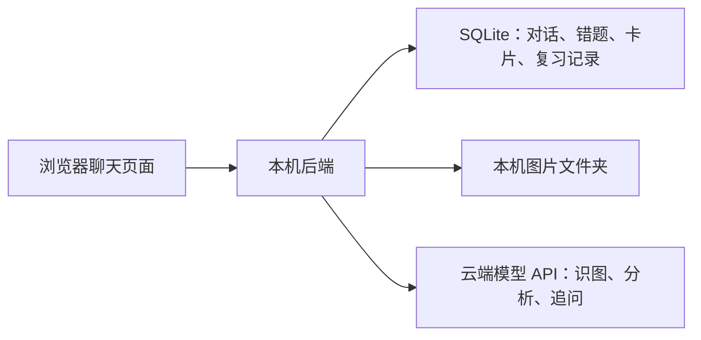

# 课程错题复习助手：首版设计确认稿

v0.3 · 2026 年 10 月 12 日 · WHY CodingKing

本稿合并前几轮的产品决定，按比赛附件 2 的六章组织。标为“已确认”的内容来自队长的选择；技术选型和具体字段作为建议供整体审阅。8 道验收候选题与答案检查表已准备，待队长或组员抽查。当前成果为设计与验收材料，模型调用与应用实现尚未开始。

## 当前决定一览

| 项目 | 当前决定 | 状态 |
| --- | --- | --- |
| 面向用户 | 普通理工科大学生，学校和教材可作为补充背景 | 当前方向 |
| 能力路线 | 使用通用大模型 API 讲解题目、分析学生解答 | 当前方向，具体模型待核实 |
| 两个主要入口 | 错题复习＋个人知识库；知识卡来自保存的错题 | 已确认 |
| 输入 | 文字、公式、印刷题截图 | 已确认 |
| 截图处理 | 先展示可修改的识别题干，用户确认后再分析 | 已确认 |
| 分析展示 | 默认错误位置＋简短提示，完整解答点击展开 | 已确认 |
| 主界面 | 聊天为主，侧边查看错题和知识卡 | 已确认 |
| 保存 | 先预览、修改知识卡，再与错题一起保存 | 已确认 |
| 复习 | 重做原题，记录结果与掌握情况 | 已确认 |
| 使用方式 | 组员先在队长的电脑上轮流试用 | 已确认 |
| 演示与验收课程 | 线性代数＋高等数学，各选少量典型题 | 已确认 |
| 工作方式 | 逐轮确认设计，再分批进入代码实现 | 已确认 |

## 一、作品概述

### 拟写入参赛文档的定位草案

本作品拟面向理工科大学生，提供以对话为入口的课程错题分析与个人知识整理工具。学生可输入题目、自己的解答，或上传印刷题截图；截图识别结果经用户校对后，再由通用大模型分析疑似出错步骤，先给出简短提示，按需展开完整讲解。用户可以继续追问，并在预览、修订知识卡片后，将错题与关联知识一起保存。个人知识库随日常做题逐步积累，复习时重做原题，记录新的解答和掌握情况。首版采用本机演示方式，重点验证从输入、错因分析到知识整理和再次练习的完整流程，减少预先整理整套课程资料的工作。

这段文字描述拟实现的产品。最终提交时，应根据实际完成情况改写，并填入真实的演示与验证结果。

### 一次完整使用过程

1. 新建一道题的对话，输入文字与公式，或上传印刷题截图。
2. 截图先形成可编辑题干；用户对照原图校正公式和条件，点击确认。
3. 输入或补充自己的解答。参考答案、指定解法、教材片段可以作为补充。
4. 查看错误位置和简短提示；按需展开完整解答，或继续追问。
5. 点击保存，预览并修订知识卡，将错题与卡片一起保存。
6. 从侧边栏打开错题或知识卡，查看两者的关联。
7. 进入原题复习，提交新解答，保存本次结果与掌握情况。

只有题干时，产品提供题目讲解和提示；有学生的解答时，才分析其具体错误。正确解答、信息不足和无法判断，也应有对应反馈。

## 二、创新性

建议集中展示以下三项产品设计，并用实际效果证明：

| 设计重点 | 用户体验 | 验证依据 |
| --- | --- | --- |
| 围绕学生自己的步骤分析 | 将疑似错误对应到输入中的具体步骤，先提供提示 | 人工核对错误位置、原因和提示是否恰当 |
| 错题与个人知识相互关联 | 一道错题形成可编辑知识卡，卡片可返回原题 | 演示预览、修订、保存和双向查看 |
| 原题再次练习 | 保留首次错误与后续解答，查看修正过程 | 演示两次作答记录及掌握状态 |

通用模型是本项目采用的基础服务；作品的设计、实现与验证过程需要独立记录。与现有错题工具的具体比较，放在原型完成后依据真实体验补充。

## 三、湛卢原生 IDE 能力运用

进入开发后，将这份确认稿拆成小任务，在湛卢中完成相应开发环节，并保留可解释的证据：

| 环节 | 拟实施内容 | 拟保留材料 |
| --- | --- | --- |
| 需求与方案 | 根据确认稿形成页面、数据和任务清单 | 队长确认后的需求版本 |
| 生成与修改 | 分批实现聊天、模型调用、保存和复习功能 | 任务提示、关键生成结果和人工修改理由 |
| 调试与评审 | 处理识别结果校对、保存关联、模型异常等真实问题 | 问题、定位过程与修复记录 |
| 验证 | 用小样本和完整流程检查功能 | 测试记录、失败案例和修正结果 |

比赛对湛卢开发能力的考察与应用运行时的模型调用分别说明。最后只写实际使用过的能力。[官方赛题与规则](https://ecloud.10086.cn/api/query/developer/match/matchDetails.html?id=8c5343ad69dd4e82bf7af642c14c8ff5)

## 四、技术实现

### 4.1 聊天页面设计

以下为已确认聊天布局的具体设计建议：

| 页面区域 | 内容 | 主要操作 |
| --- | --- | --- |
| 左侧栏 | 新建题目、最近对话；错题和知识卡的切换列表 | 打开记录、查看关联、进入复习 |
| 中央对话区 | 用户输入、原图与可编辑题干、分析回复、后续追问 | 确认题干、展开解答、追问、保存 |
| 底部输入区 | 文字与公式输入、截图附件、发送按钮 | 提交题目或补充自己的解答 |
| 侧边详情 | 选中的错题或知识卡详情 | 查看原题、编辑内容、查看复习记录 |

建议每段对话围绕一道题展开。开始另一题时新建对话，便于保存清晰的题目、卡片和复习关系。

分析回复建议包含“问题判断、对应步骤、简短提示、展开完整解答、保存错题”几个部分。继续追问仍保留当前题目背景。公式在消息、题干和知识卡中保持一致的阅读方式。

### 4.2 功能与验收清单

下表把已确认流程展开为具体行为，供整体审阅；其中的提示文字和按钮名称可在页面草图中调整。

| 编号 | 功能 | 输入与输出 | 验收重点 |
| --- | --- | --- | --- |
| F01 | 文字和公式输入 | 输入题干及自己的解答，形成可继续追问的对话 | 题目条件和公式可读，输入内容得到保留 |
| F02 | 截图识别与校对 | 印刷题截图 → 原图＋可编辑题干 → 用户确认 | 修改后的题干进入分析，原图可以回看 |
| F03 | 错因分析与讲解 | 题干＋学生解答 → 错误位置、提示和完整讲解 | 有正确、错误、信息不足等结果，避免强行找错 |
| F04 | 连续追问 | 围绕当前题目提问 → 结合当前题干和解答解释 | 能回答“为什么这一步错了”等追问，保存内容可回到对应对话 |
| F05 | 错题与卡片保存 | 当前题目和分析 → 可编辑知识卡预览 → 一起保存 | 用户修订被保留，卡片能返回正确原题 |
| F06 | 个人知识库 | 查看、修改卡片及关联错题 | 可读公式、易错提醒和关联记录正常显示 |
| F07 | 原题复习 | 原题＋新解答 → 本次结果和用户掌握状态 | 新记录保留，首次解答仍可查看 |
| F08 | 本地记录与异常处理 | 对话、图片、错题、卡片、复习记录 | 重开后可恢复记录；请求失败保留输入并显示重试入口 |

保存错题与卡片应作为一个明确操作；重复点击应避免生成重复记录。改写题干或解答后，重新分析的结果需要与本次内容对应，已有记录保留其原来的内容。

### 4.3 知识卡片与原题复习

卡片字段建议：知识点名称、核心内容与适用条件、自己的易错提醒、关联错题、AI 整理及用户修订状态。

保存流程已经确认：**预览卡片 → 用户可修改 → 与错题一起保存**。预览允许用户跳过不合适的知识点；与题目无关的扩展内容不应自动成为个人知识。

复习流程已经确认以原题为主。建议进入复习时先展示题目，将原解答折叠；用户提交新的解答后，再查看反馈和前后记录。掌握状态由用户选择，例如“还需复习”“基本理解”，与模型对本次答案的判断分别记录。

### 4.4 建议的本机架构

| 部分 | 推荐方案，待整体确认 | 作用 |
| --- | --- | --- |
| 页面 | React＋TypeScript | 组织聊天消息、可编辑题干、侧栏与卡片预览 |
| 公式展示 | KaTeX | 将支持的数学表达式显示为可读公式；具体输入约定和兼容范围在实现前列明 |
| 后端 | Python＋FastAPI | 管理请求、调用云端模型、保存学习记录 |
| 数据保存 | SQLite＋本机图片文件夹 | 让学习记录在关闭页面、重新启动后仍可恢复 |
| 模型服务 | 优先评估移动云 MoMA | 提供图片识别和题目分析能力；型号、权限和额度待核实 |

选择理由：这一方案能够将页面交互、模型调用和记录保存分别组织，适合当前本机演示范围。SQLite 官方文档将设备本地数据存储和演示列为适用场景。这是技术建议，尚未创建应用、安装依赖或构建数据库。

参考：[React 文档](https://react.dev/learn)、[FastAPI 文档](https://fastapi.tiangolo.com/)、[KaTeX 支持的公式功能](https://katex.org/docs/supported)、[SQLite 适用场景](https://www.sqlite.org/whentouse.html)。

### 4.5 需要保存哪些数据

| 数据 | 主要内容 | 用途 |
| --- | --- | --- |
| 对话 | 题目对应的会话、用户消息、模型回复 | 继续追问和查看分析过程 |
| 题目与作答 | 确认后的题干、学生解答、可选参考答案、原图路径 | 保留当时实际分析的输入 |
| 分析记录 | 对应输入的判断、错误位置、提示、完整讲解 | 展开讲解与追溯保存来源 |
| 知识卡 | 用户确认保存的知识、提醒、关联错题 | 个人知识回顾 |
| 复习记录 | 原题、新解答、反馈、用户掌握状态、时间 | 查看多次练习过程 |

已确认组员先在队长的电脑上轮流试用。据此，首版按本机单用户演示空间设计，学习记录保存在这台电脑，测试时用题号和批次区分。将来需要多台设备或独立个人账号时，再扩展相应的数据与访问方案。

这里的数据库保存使用过程中产生的记录。通用学科知识由模型提供，课程材料按需补充；个人知识库可以随错题积累而运行。

### 4.6 模型 API 路线与已核查依据

2026 年 10 月 12 日查阅的移动云官方《Qwen 模型图片理解 API 调用》说明了截图文字识别和图像数学题解答场景，列出了 Qwen2.5-VL 系列的 API 支持，并支持 URL 或 Base64 图片输入。因此，上传印刷题截图这一设计有公开接口依据。

来源：[Qwen 模型图片理解 API 调用](https://ecloud.10086.cn/op-help-center/doc/article/93315)、[快速调用模型广场模型 API](https://ecloud.10086.cn/op-help-center/doc/article/100002)。平台文档有此能力，不等于当前账号已经能够使用，也不代表所有公式都能识别正确。

推荐分两步调用：

1. **识别阶段：** 图片形成题干和公式草稿，展示原图与不确定位置，等待用户校对确认。
2. **分析阶段：** 依据确认后的题干和学生解答，返回提示、完整讲解与候选知识卡。原图包含必要图形时保留图片背景，不能仅凭残缺识别文本补全条件。

完整讲解默认折叠；建议与初次分析一起生成，展开时直接显示。保存前的卡片预览复用本次生成内容。后续追问、修改输入后再分析和重新作答的分析，根据操作发起新请求。

模型可以是同一个支持图文的服务，也可以由视觉模型负责识别、文字模型负责分析；具体组合根据账号可用资源和少量试题效果决定。

图片可通过 Base64 直接随请求传入。按这一方案，本机只需能够访问模型服务，无需先搭建公开图片地址。图片大小、格式和接口地址在选定实际模型后按其官方文档确认。

API Key 由后端配置使用。下一阶段核实账号可用模型、额度、接口连通性和样题表现后，再确定实际调用配置。本轮仅查阅公开文档，未使用密钥调用模型。

## 五、应用价值与验收计划

### 已确认的首版演示范围

验收课程已确定为线性代数和高等数学，各选少量典型题。已准备两科各 4 道，共 8 道候选题，用于检查文字、公式、截图、错误分析和边界情况。

| 题号 | 学科与内容 | 主要检查点 |
| --- | --- | --- |
| L01 | 行列式换行 | 定位符号错误，保留对正确计算步骤的判断 |
| L02 | 线性方程组 | 区分有解与唯一解，正确解释特解与通解 |
| L03 | 特征向量 | 识别正确解答，避免强行找错 |
| L04 | 行列式条件不足 | 说明信息不足并提出补充要求 |
| C01 | 复合函数求导 | 识别遗漏内层导数 |
| C02 | 定积分换元 | 识别上下限没有同步变换 |
| C03 | 基本极限 | 未提供学生解答时给提示，遵守指定方法 |
| C04 | 连续与可导 | 区分函数值、连续性和左右导数 |

材料：[输入版](G:/university/移动ecloud大赛/验收材料/首版验收题_输入版.md)、[答案与检查表](G:/university/移动ecloud大赛/验收材料/首版验收题_答案与检查表.md)。参考计算已通过数学推导与 SymPy 1.14.0 核对，仍需人工抽查；应用和真实模型均尚未运行这些验收题。

另检查四个完整流程：

1. 截图识别有误时，用户修改的符号真正进入后续分析。
2. 修改知识卡后保存，重新打开能恢复错题、修订内容和关联。
3. 重做原题产生新记录，能比较前后解答和掌握状态。
4. 模型请求失败，仍保留输入和已保存记录，能够明确重试。

验收记录需区分模型答题表现与软件流程是否正常。准确率、耗时和体验改善都在实际试用后填写；不提前承诺覆盖全部理工科题型。

## 六、附件、分批实施与待确认事项

### 后续成果对应比赛模板

- 参赛说明：按六章写入实际产品、架构、效果和湛卢使用证据。
- 可运行成果：应用代码与运行说明。
- 演示：一条从截图校对到保存知识卡、再到原题复习的流程。
- 验证材料：少量样题、检查结果与已知问题。

### 建议的实施顺序

| 批次 | 目标 | 该批完成后可审阅的结果 |
| --- | --- | --- |
| 1 | 页面和本地记录 | 使用明确标记的示例内容展示聊天、侧栏、卡片预览，完成样例错题和卡片的保存、回读 |
| 2 | 接入真实模型能力 | 完成截图校对、分析和追问，核对实际请求与响应 |
| 3 | 完成学习流程 | 错题和卡片一起保存，原题复习及结果记录可用 |
| 4 | 验证与参赛材料 | 组员试用、修复问题、录制演示并完成正式说明 |

这张表是实施建议，不表示已授权或已开始上述开发。

### 首批实现清单：供开工前整体确认

建议采用上文的 React＋TypeScript 页面、Python/FastAPI 后端、SQLite 本机保存方案，公式使用 KaTeX，后续模型优先评估 MoMA。

| 首批任务 | 可检查的结果 |
| --- | --- |
| 开发环境核实 | 确认湛卢原生 IDE 的实际可用入口，安排并记录真实的开发使用过程 |
| 聊天与侧栏 | 可新建题目、输入文字与公式，查看示例对话、错题和知识卡 |
| 校对和讲解交互 | 可展示原图与可编辑题干，确认后展示标为示例的分析；提示在前，完整解答可展开 |
| 卡片预览与保存 | 可以修改候选知识卡，将样例错题和卡片一起保存并回读 |
| 本机数据恢复 | 重新启动后样例记录保留，关联原题正确，重复保存有一致行为 |

首批页面中使用明确标记的示例内容验证交互。真实截图识别、模型分析与连续追问在下一批接入，进入该批前核实账号可用模型、额度与实际效果。

### 当前剩余决定

产品交互、验收课程和试用方式已经确定。还需要队长整体确认技术方案与首批开工范围；确认开始后，按上面的任务清单进入实现。
